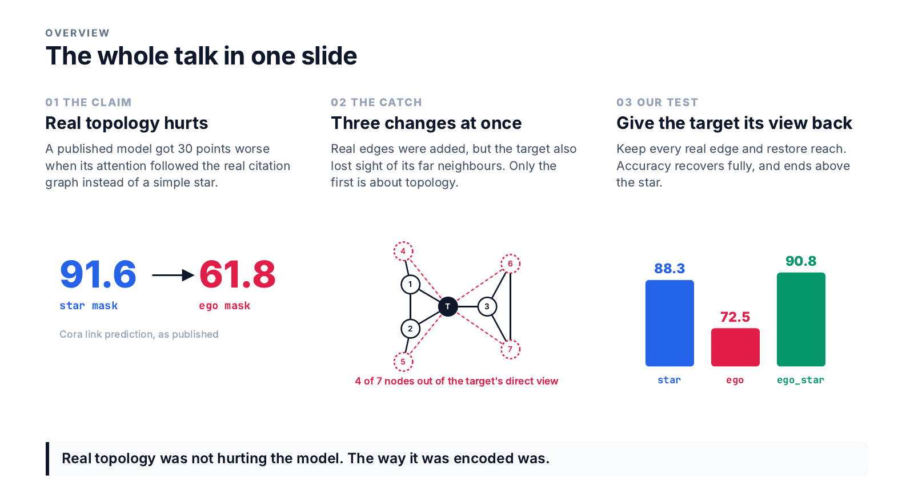
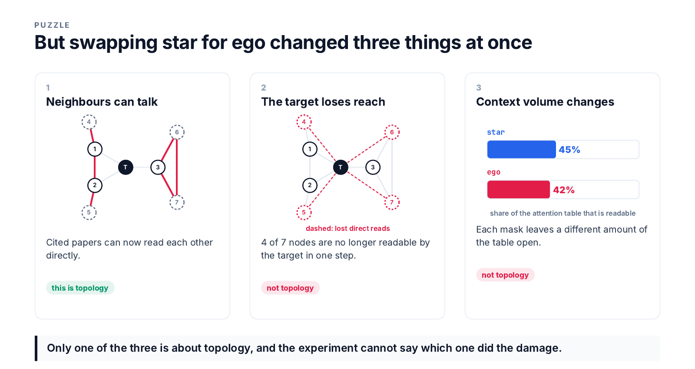
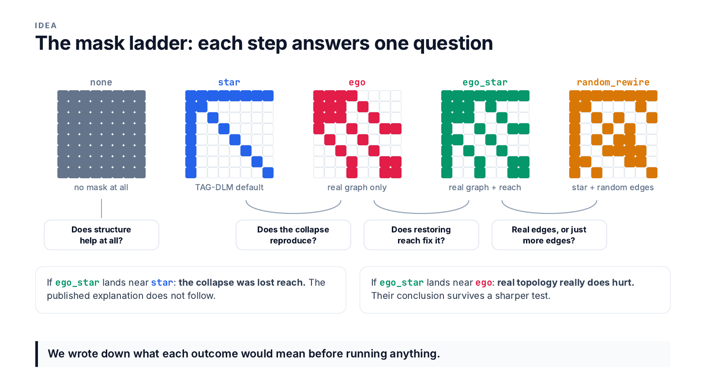
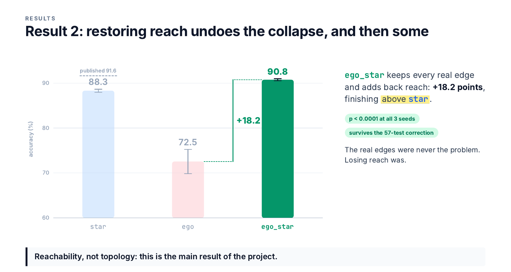

# PLEXUS: Reachability, Not Topology

**Graph attention masks in diffusion language models.**
Adele Chinda, Haoxin Wang, Esra Akbas · Department of Computer Science, Georgia State University

A published result says that when a diffusion language model is shown a node's *real* citation
graph instead of a simple star-shaped abstraction, it gets almost **30 points worse** at link
prediction, and concludes that real graph structure is harmful. We show the experiment cannot
support that conclusion, find what actually causes the drop, and repair it without giving up a
single real edge.



**In three sentences.** The star mask and the real-graph mask differ in three ways at once, and
only one of them is about topology. Holding everything else fixed and restoring only the target
node's ability to read its whole neighbourhood recovers the entire collapse and finishes *above*
the star mask, at p < 0.0001 at every seed. Real topology was never the problem; the way it was
encoded hid the far half of the neighbourhood from the node being predicted.

---

## The problem

[TAG-DLM](https://arxiv.org/abs/2606.31166) (Chen et al., 2026) handles text-attributed graphs
with a masked diffusion language model, [LLaDA-8B](https://arxiv.org/abs/2502.09992). It samples
a node's neighbourhood, writes every paper's title and abstract into one token sequence, and
injects the graph as a **binary attention mask** that decides which papers' tokens may read which.
No graph neural network is involved.

Its default mask is a *star*: the target reads every sampled paper and every paper reads the
target, but neighbours never read each other. Its ablation swaps in the *ego* mask, where attention
follows the real citations. On Cora link prediction accuracy falls from **91.62 to 61.76**.



That swap changed three things together:

1. **Neighbour-to-neighbour edges** appear. This is the only change that is about topology.
2. **The target loses reach.** A paper two hops away shares no edge with the target, so under the
   ego mask the target cannot read it at all. In the example above, that is 4 of the 7 papers.
3. **Context volume changes.** The masks leave different fractions of the attention matrix open
   (45% for star against 42% for ego on link prediction).

## The experiment: a ladder of masks



Five masks over the same sampled subgraph, each adjacent pair differing in exactly one respect:

| mask | what it allows | question it answers |
|---|---|---|
| `none` | everything (the unmodified model) | does structure help at all? |
| `star` | target ↔ everyone; neighbours isolated | TAG-DLM's default |
| `ego` | real citations only | does the collapse reproduce? |
| **`ego_star`** (ours) | real citations **plus** the target's reach | does restoring reach alone fix it? |
| `random_rewire` | star plus as many *random* edges as ego has real ones, same density as `ego_star` | real edges, or just more edges? |

We also test **HopBias**, a graded alternative: instead of an on/off switch per pair, one learned
scalar per shortest-path distance is added to the attention logits. At zero it is bit-identical to
the unmodified model, so it can never be forced to use structure, and it provably contains every
mask in the ladder as a limit.

## Results



Cora, LLaDA-8B frozen with a LoRA adapter, accuracy in %, mean ± standard deviation over three
seeds. ρ is the share of the attention matrix left readable.

| mask | link prediction | ρ | node classification | ρ |
|---|---:|---:|---:|---:|
| `none` | 89.59 ± 0.37 | 1.000 | 86.59 ± 1.08 | 1.000 |
| `star` | 88.31 ± 0.34 | 0.452 | 87.82 ± 0.98 | 0.468 |
| `ego` | 72.54 ± 2.70 | 0.415 | 86.78 ± 1.59 | 0.395 |
| **`ego_star`** | **90.75 ± 0.23** | 0.606 | 87.76 ± 1.08 | 0.560 |
| `random_rewire` | 88.49 ± 0.82 | 0.605 | 88.50 ± 0.75 | 0.561 |
| HopBias | 89.85 ± 0.53 | 1.000 | 87.02 ± 1.05 | 1.000 |
| HopBias + answer grading | 90.24 ± 0.79 | 1.000 | 86.81 ± 1.80 | 1.000 |
| *TAG-DLM, reported* | *star 91.62, ego 61.76* | | *star 90.96* | |

**What holds.**

- **The collapse reproduces:** `ego` costs **15.77 points** against `star`.
- **Restoring reach undoes it:** `ego_star` recovers **18.21 points** and finishes 2.44 above
  `star`. On the 452 test pairs of seed 0 the two masks disagree on 140, and 111 of those go
  `ego_star`'s way.
- Both effects give **p < 0.0001 at all three seeds**, and they are the only comparisons that
  survive a Bonferroni correction across all 57 paired tests we ran (threshold 0.0009).

**What does not, and we say so.**

- **Real versus random edges is unsettled.** Real edges lead density-matched random ones by
  +2.27 points with the same sign at every seed, but p = 0.045, 0.038, 0.345. Adding random edges
  to the star changes nothing (+0.17).
- **HopBias is a null.** It lands level with no structure at all. It is more expressive than any
  mask, but on Cora the optimiser did not use the extra freedom.
- **Node classification resolves nothing.** The whole ladder spans 1.91 points while single masks
  vary by up to ±1.8 between seeds; even the collapse does not separate there. Text alone already
  carries most of a paper's topic.
- **The published absolute numbers are not reproduced.** Our `star` sits 3.14 (node
  classification) and 3.31 (link prediction) points below them. TAG-DLM released no code, so every
  claim here is a comparison inside one harness, which is all the ladder needs.

## How we decided what counts

Most of this project's effort went into knowing what the instrument can and cannot resolve.

- **A measured noise floor.** The same configuration, seed and code, run on two different GPUs,
  disagrees by up to **1.29 points**. No gap below that is called a difference, whatever its sign.
  This measurement retired an early result of ours: a +1.84-point gain from answer grading on one
  machine reversed sign on the other.
- **Decisions, not averages.** Arms are compared with McNemar's test over the same test examples,
  counting only the examples where they disagree.
- **Correction for many tests.** Reporting every seed as its own replicate gives 57 tests, where
  an uncorrected 0.05 would be met by chance somewhere. The corrected threshold is emitted by the
  results script, so the write-up cannot drift from the number of tests actually run.
- **Generated numbers.** Every figure quoted in the paper, reports and slides is a macro written by
  `scripts/collect_results.py` from the run artefacts in `experiments/`. Nothing is typed by hand.

## Scale

| | |
|---|---|
| Training runs | 44 LoRA fine-tuning runs, 3 seeds per arm |
| Frozen evaluations | 31, on Cora and PubMed |
| Compute | ≈ 497 GPU-hours, mostly on 8 × RTX A6000 48 GB; ≈ 12 h per link-prediction run |
| Model | LLaDA-8B-Instruct, frozen; LoRA rank 64 on all 7 projections of 32 blocks, 167.8 M trainable (2.09%) |
| Tests | 82 (14 of them need the LLaDA weights cached and skip otherwise) |
| Experiment log | [`docs/EXPERIMENT_LOG.md`](docs/EXPERIMENT_LOG.md), one dated entry per finding, including the ones that went against us |

Sequences are padded to a multiple of 128 rather than a fixed 2048, which costs 0.472× the linear
compute and is what made three seeds per arm affordable.

## Reproducing

**Environment.** Python ≥ 3.10, PyTorch 2.5.1 built for CUDA 12.1, one GPU with ≥ 24 GB.

```bash
pip install torch==2.5.1 --index-url https://download.pytorch.org/whl/cu121
pip install -e ".[dev]"
```

**Data and model.** Cora with raw titles and abstracts, from the TAPE archive. The backbone is
`GSAI-ML/LLaDA-8B-Instruct` from Hugging Face, loaded with `trust_remote_code`. Keep both on
persistent storage, not `/tmp`:

```bash
export PLEXUS_DATA_ROOT=$PWD/data
export HF_HOME=$HOME/.cache/huggingface
pip install gdown
cd data && gdown 1hxE0OPR7VLEHesr48WisynuoNMhXJbpl -O cora_orig.zip && unzip cora_orig.zip && cd ..
```

**One run.** Every run in `experiments/` was produced by a single command of this form; the exact
command for each is recorded in `scripts/queue_*.txt`.

```bash
python scripts/run_experiment.py --task lp --dataset cora --mask-family ego_star \
    --seed 0 --epochs 6 --eval-every-epochs 2 --out experiments/mine/ego_star_lp_s0
```

`--mask-family` takes `none`, `star`, `ego`, `ego_star` or `random_rewire`; add
`--mask-family none --hop-bias-buckets 6` for HopBias, `--hop-bias-answer-as-target` to grade the
answer slot too, and `--no-lora` for a frozen evaluation.

**A whole ladder.** `scripts/run_queue.sh` works through a queue file, waiting for a free GPU
before each job; it is resumable and several workers can share one queue.

```bash
ONLY_GPU=0 ./scripts/run_queue.sh scripts/queue_lp.txt &
ONLY_GPU=1 ./scripts/run_queue.sh scripts/queue_lp.txt &
```

**Tables and tests.**

```bash
python scripts/collect_results.py --out results.tex      # every table and number, from experiments/
python scripts/compare_decisions.py experiments/titan3/L_ego_star_lp_s0 experiments/titan3/L_ego_lp_s0
python -m pytest tests/ -q
```

## Repository layout

```
plexus/
├── masks.py        the five mask families, HopBias, density measurement
├── data/           Cora and PubMed loading, ego-graph sampling, linearisation
├── prompts/        prompt templates and token-span bookkeeping
├── models/         LLaDA adapter and LoRA attachment
├── metrics/        accuracy and attention diagnostics
└── train/          the fine-tuning harness
scripts/            run_experiment, the run queue, results collection, paired tests, figures
tests/              unit tests, including ones that run the real LLaDA code at two layers on CPU
experiments/        one directory per run: config, training history, per-example predictions
docs/               research plan, experiment log, README figures
```

The manuscripts (paper, final report, status report, proposal, literature survey) and the talk are
generated from these artefacts but are not part of the repository.

## Limitations

Everything is on Cora, chosen deliberately because the question is mechanistic; whether the
mechanism holds on other graphs is open. Three seeds settle the large effects but not the 2-point
density gap. The learned HopBias weights were not saved, so we know the graded bias did not help
but not what shape it learned. And because TAG-DLM's preprocessing is not fully specified, our
reproduction rests on stated assumptions and our absolute numbers sit about three points below
theirs.

**Next steps:** save and inspect the learned λ; a power analysis and more seeds for the density
control; the same ladder on Citeseer or PubMed, where the prediction is that the recovery grows
with the share of hop-2 nodes; and an autoregressive backbone of the same size as a control.

## Key references

- **TAG-DLM:** Chen, Bei, Xu, Zhao, Chen & Tong. *Diffusion Language Models for Text-Attributed
  Graphs.* [arXiv:2606.31166](https://arxiv.org/abs/2606.31166), 2026. The result this project
  re-examines.
- **LLaDA:** Nie et al. *Large Language Diffusion Models.* NeurIPS 2025. The backbone.
- **MDLM:** Sahoo et al. *Simple and Effective Masked Diffusion Language Models.* NeurIPS 2024.
- **Graphormer:** Ying et al. *Do Transformers Really Perform Badly for Graph Representation?*
  NeurIPS 2021. The origin of the distance-indexed attention bias HopBias adapts.
- **LoRA:** Hu et al. *Low-Rank Adaptation of Large Language Models.* ICLR 2022.

---

*Graph Machine Learning (Section 002), Georgia State University, Fall 2026.*
